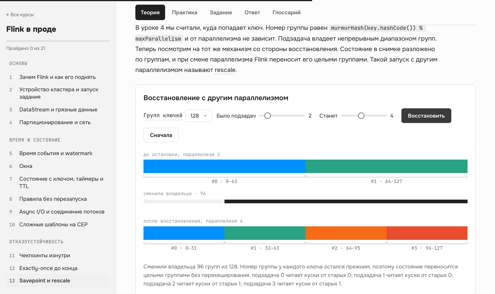

<picture>
  <source media="(prefers-color-scheme: dark)" srcset=".github/assets/banner-dark.svg">
  
</picture>

<p align="center">
  <a href="https://github.com/LuminiteTime/study/actions/workflows/ci.yml"></a>
  <a href="LICENSE"></a>
  <a href="https://study.luminais.tech/"></a>
  <a href="https://flink.apache.org/"></a>
  <a href="https://openjdk.org/projects/jdk/17/"></a>
</p>

Free courses in Russian for developers who want to know how their tools work inside. A course follows one project from the first local run to production, and when it explains how the framework behaves, it links to the lines of source code that do it. Each course builds into a single HTML file that also works offline.

<table>
  <tr>
    <th align="left">Course</th>
    <th align="left">What you build</th>
    <th align="left">Lessons</th>
  </tr>
  <tr>
    <td><a href="https://study.luminais.tech/flink/"><b>Flink в проде</b></a><br><sub>Apache Flink 2.2 for Java developers who know Spark</sub></td>
    <td>PayGuard, a fraud detector for a stream of payments, taken from a local Docker setup to Kubernetes, with monitoring, a chaos test and an outage post-mortem</td>
    <td align="center">21</td>
  </tr>
</table>

<picture>
  <source media="(prefers-color-scheme: dark)" srcset=".github/assets/course-dark.png">
  
</picture>

> I only understand a tool once I've seen what it does under the hood and broken it on something close to production. So that's how these courses go: one project, taken all the way to production and then broken on purpose, with the framework's source code open next to the text.
>
> <sub>Mikhail Trifonov</sub>

## Build a course locally

You need Node.js 24 and Python 3.12. Java 17 is only for the Checkstyle run.

```bash
git clone https://github.com/LuminiteTime/study.git
cd study/Flink/course
npm ci
python3 -m pip install -r requirements.txt
npm run build     # writes index.html, open it in a browser
```

Before a pull request, run the same checks as CI:

```bash
npm run lint       # file size, ESLint, Stylelint, ruff, prose
npm run lint:java  # Checkstyle over the project snapshots
```

The finished project after every lesson sits in `Flink/solutions/lesson-NN`. If your own copy falls behind or breaks, continue from that folder.

<details>
<summary><b>Repository layout</b></summary>

```text
home/                  catalog page at the site root, plain HTML and CSS
Flink/course/          lessons, styles, diagrams, build and lint tools
Flink/solutions/       PayGuard snapshot after each lesson
.github/workflows/     lint and build on every push, deploy to Pages from main
```

A new course goes into its own folder next to `Flink/`. Add a row to `home/index.html` and a copy step to the `Assemble site` step in `ci.yml`.
</details>

## License

[MIT](LICENSE). `Flink/course/sources/` holds excerpts from Apache Flink, the Flink Kafka connector, Flink CDC and the Flink Kubernetes Operator that the lessons quote; they stay under the Apache License 2.0 with their headers intact. The built course bundles [D3](https://d3js.org/) (ISC) and [GSAP](https://gsap.com/) under the [GSAP standard license](https://gsap.com/standard-license/).
